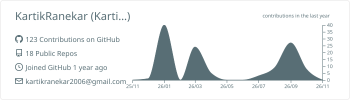
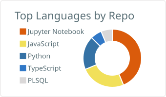
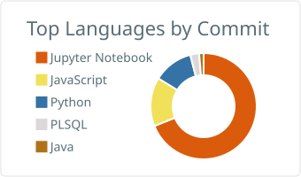
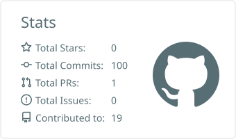
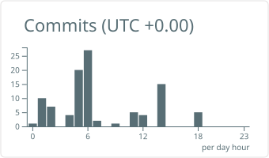

 

---

## 01 / A LITTLE ABOUT ME

I'm **Kartik** — a Computer Science undergraduate at **Symbiosis Institute of Technology, Nagpur**, interested in the space where **AI meets real-world software**.

I enjoy the whole build process: understanding a problem, shaping the logic, building the backend, and turning the result into something people can actually use. Lately, that has meant working on explainable ML, LLM-powered tools, retrieval workflows, and agentic applications.

I’ve also worked as an **AI Research Intern at UptoSkills (SyncAura AI)**, contributing to AI-powered productivity and certificate-generation experiences.

**Currently exploring** · RAG systems · Vector search · LangChain / LangGraph · Agent workflows · Backend engineering

 

  
  
  

---

## 02 / SELECTED BUILDS

<table>
  <tr>
    <td width="50%" valign="top">
      <h3>01 &nbsp; RISKGUARD</h3>
      
<b>Explainable transaction fraud detection</b>

      
ML-based risk scoring paired with SHAP explanations, an investigation workspace, human review, and AI-generated audit briefs.

      
PYTHON · RANDOM FOREST · SHAP · FASTAPI · REACT · GEMINI

      <a href="https://github.com/KartikRanekar/Random_Forest_Powered_Transaction_Fraud_Detector">EXPLORE REPOSITORY ↗</a>
    </td>
    <td width="50%" valign="top">
      <h3>02 &nbsp; ACADEMIC AI</h3>
      
<b>Autonomous writing &amp; review agent</b>

      
Academic text refinement, evidence retrieval, claim verification, and consolidated research analysis in one workflow.

      
REACT · VITE · NODE.JS · EXPRESS · TAVILY · LLM APIS

      <a href="https://github.com/KartikRanekar/Academic-Writing-Agent">EXPLORE REPOSITORY ↗</a>
    </td>
  </tr>
  <tr>
    <td width="50%" valign="top">
      <h3>03 &nbsp; MULTI-PURPOSE AGENT SUITE</h3>
      
<b>A practical collection of AI utilities</b>

      
A Gemini-powered toolkit for chat, summarisation, tone conversion, resume bullets, study plans, captions, and design themes.

      
PYTHON · GEMINI API · MODULAR CLI

      <a href="https://github.com/KartikRanekar/Multi-Purpose-Agent">EXPLORE REPOSITORY ↗</a>
    </td>
    <td width="50%" valign="top">
      <h3>04 &nbsp; PRODUCTION RAG LAB</h3>
      
<b>Learning retrieval systems by building</b>

      
An active hands-on build exploring document ingestion, embeddings, vector search, and retrieval-augmented generation.

      
PYTHON · LANGCHAIN · CHROMA · LANGGRAPH · HUGGING FACE

      <a href="https://github.com/KartikRanekar/Production_RAG_with_Vector_Database_LangChain">EXPLORE REPOSITORY ↗</a>
    </td>
  </tr>
</table>

  
<b>More projects &amp; experiments</b> — open to explore

   

  - **[Task Manager Mobile App](https://github.com/KartikRanekar/TaskManager-App-using-Expo)** — cross-platform task management with Firebase authentication and Firestore.
  - **[Resume Screening with ML](https://github.com/KartikRanekar/Resume_Screening_with_Mchine_Learning)** — resume text processing, TF-IDF features, and job-category classification.
  - **[Hate Speech Detection](https://github.com/KartikRanekar/Hate_Speech_Detection_Model)** — NLP preprocessing and text classification for content moderation.
  - **[Transaction Fraud Detection](https://github.com/KartikRanekar/Random_Forest_Powered_Transaction_Fraud_Detector)** — model evaluation, explainability, and a full-stack investigation workflow.
  - **[AI / ML Repository](https://github.com/KartikRanekar/AI_ML_Repo)** — foundational model training, data exploration, and evaluation.

---

## 03 / THE TOOLKIT

<b>CORE LANGUAGES</b>

<b>AI / MACHINE LEARNING / GENAI</b>

<b>APPLICATION DEVELOPMENT</b>

<b>DATA / TOOLS / WORKFLOW</b>

---

## 04 / GITHUB PULSE

  
    
  
  
    
  
  

---

## 05 / FIND ME

  

Curious mind. Builder's mindset. Always working on the next idea.

